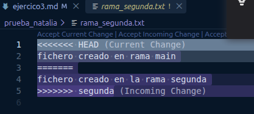
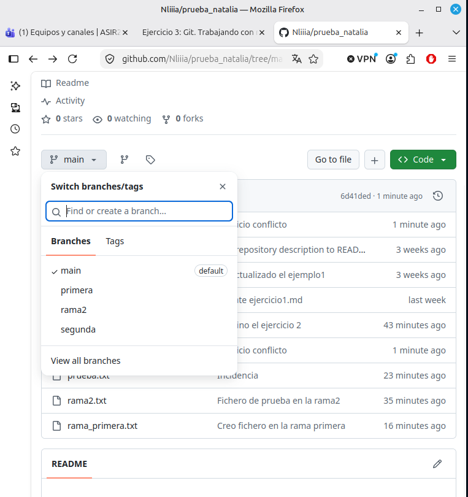

## Pregunta 1  
No se produjo ningun error porque lo que he hecho ha sido crear un fichero en una rama y luego hacer merge en main, no hay conflictos porque los cambios hechos no chocan con ningun cambio hecho en la rama main ya que el fichero es nuevo para la rama main.  

## Contenido fichero con conflicto  
  

## Prueba de creacion de la rama segunda
